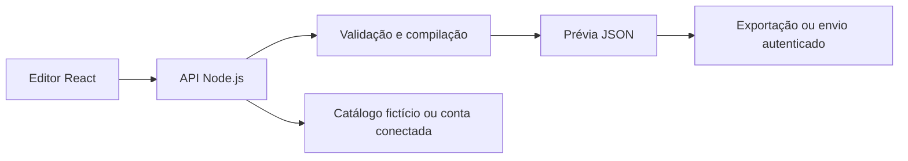

# Bot Analyser — Criador de robôs de atendimento

Editor visual para transformar um roteiro de atendimento em um robô V3 da Digisac. A pessoa monta menus, mensagens, transferências e regras; o sistema valida o roteiro, simula a conversa e gera uma prévia JSON.

O projeto concentra a criação e a revisão do fluxo em uma interface. O compilador é determinístico: a geração do JSON usa regras de domínio, sem chamadas a modelos de IA.

## Funcionalidades

- Criação guiada por perguntas ou edição direta dos caminhos do atendimento.
- Menus e submenus, mensagens, transferências para departamentos e encerramento.
- Regras de entrada, horário, feriados, inatividade e avaliação após fechamento.
- Mapa do fluxo, revisão de pendências e simulação local da conversa.
- Rascunhos no navegador, separados por conta e origem.
- Consulta de departamentos, atendentes e avaliações de uma conta conectada.
- Validação, exportação JSON e envio autenticado para criar um robô.

## Tecnologias e arquitetura

| Camada    | Tecnologias                                           |
| --------- | ----------------------------------------------------- |
| Interface | React, TypeScript, Vite                               |
| Backend   | Node.js 24, TypeScript                                |
| Domínio   | Contratos, validação e compilação determinística      |
| Qualidade | Test runner do Node, TypeScript, Prettier, Playwright |



A interface edita o roteiro; o backend consulta o catálogo e executa as regras de domínio. A simulação percorre o roteiro localmente. A integração externa fica separada do compilador.

## Instalação

Requisitos: Git, npm e Node.js 24 compatível com `package.json`. A versão indicada em `.node-version` é 24.13.1.

```sh
git clone https://github.com/NicolasLimao/bot_analyser-publico.git
cd bot_analyser-publico
npm ci
npm run build
npm start
```

Abra **http://127.0.0.1:3001**.

### Experimentar sem conta

1. Escolha **Experimentar com dados de demonstração** na tela inicial.
2. Abra um modelo ou crie um roteiro; ajuste mensagens, opções e destinos.
3. Use a simulação para percorrer os caminhos e a revisão para resolver pendências.
4. Exporte a prévia JSON para inspecionar o resultado.

Os dois catálogos são fictícios. O perfil `snapshot` mantém esse nome por compatibilidade, mas seus 12 departamentos e identificadores foram inventados para esta edição. Ele não contém usuários nem consulta uma conta real.

Para usar a integração, conecte uma instância com suas próprias credenciais pela interface. Senha e token não entram no roteiro exportado; as sessões ficam na memória do servidor e desaparecem ao expirar ou reiniciar o processo.

## Desenvolvimento e configuração

Em dois terminais, na raiz do projeto:

```sh
# Terminal 1
npm run dev:api
```

```sh
# Terminal 2
npm run dev:web
```

A interface de desenvolvimento fica em **http://127.0.0.1:5173**. Use [.env.example](.env.example) como referência para um `.env` local, caso precise alterar a configuração.

| Variável        | Uso                                                      |
| --------------- | -------------------------------------------------------- |
| `HOST`          | Endereço do servidor; no desenvolvimento, `127.0.0.1`    |
| `PORT`          | Porta; no desenvolvimento, `3001`                        |
| `NODE_ENV`      | Seleciona o comportamento de desenvolvimento ou produção |
| `PUBLIC_ORIGIN` | Origem HTTPS pública, sem caminho, para a hospedagem     |

O login da interface não usa as variáveis legadas `DIGISAC_*` do exemplo. O arquivo `squarecloud.app` é uma referência de hospedagem: escolha seu próprio subdomínio e configure a origem HTTPS efetiva. Sessões em produção usam cookies Secure; o proxy deve preservar Host e HTTPS.

## Estrutura

```text
src/domain/      contratos, validações, simulação e compilação
src/digisac/     integração com a plataforma
src/server.ts   API e perfis de catálogo
web/            interface React
examples/       roteiros e catálogos fictícios
specs/          requisitos e contratos das funcionalidades
estudos/        arquitetura, laboratório e exercícios
tests/          testes unitários e cenários de navegador
```

## Testes

```sh
npm run check
npm run demo
npm run build
npx playwright install chrome
npm run test:e2e
```

`check` reúne formatação, verificação de tipos e testes unitários. Os cenários de navegador usam fixtures sintéticas e cobrem desktop e mobile. A integração real deve ser homologada na conta de destino.

## Estado e limitações

A prévia V3 é experimental (`importReady: false`). A simulação não emula a plataforma; um POST aceito não comprova ativação de canais nem o funcionamento completo do robô. Mudanças de inatividade na conta conectada podem afetar outros atendimentos e exigem revisão do operador.

Importação Word, migração de robôs legados e geração de documentação Word são propostas, ainda fora do caminho implementado. Documentos preenchidos e exportações de contas não acompanham esta edição.

## Documentação

- [Arquitetura e laboratório](estudos/README.md)
- [Produto](PRODUCT.md) e [sistema visual](DESIGN.md)
- [Contrato de catálogo](specs/002-catalogo-digisac.md)
- [Conexão e envio](specs/005-conexao-digisac.md)
- [Dados locais e política da edição pública](PUBLICATION.md)

Desenvolvido por [NicolasLimao](https://github.com/NicolasLimao).
