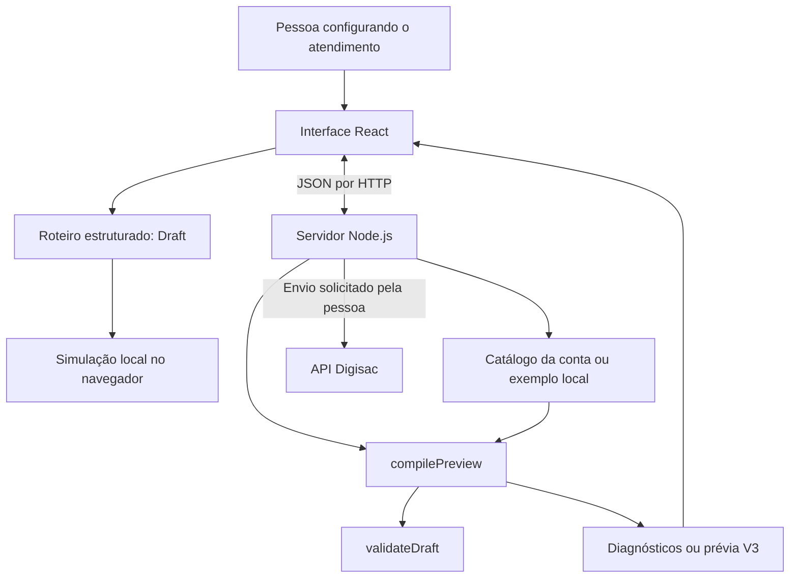

# 1. Arquitetura e mapa do código

O sistema tem uma interface React, um servidor HTTP em Node.js e um núcleo de regras em TypeScript. Não há banco de dados na implementação atual: rascunhos ficam no navegador e sessões de conexão ficam na memória do servidor.

## Onde procurar cada responsabilidade

| Arquivo ou pasta                                           | Papel                             | Comece observando                                     |
| ---------------------------------------------------------- | --------------------------------- | ----------------------------------------------------- |
| [web/src/main.tsx](../web/src/main.tsx)                     | Entrada React                     | Montagem da aplicação                               |
| [web/src/App.tsx](../web/src/App.tsx)                       | Coordenação da interface        | Estado do roteiro, prévia, armazenamento e conversa  |
| [web/src/GuidedBuilder.tsx](../web/src/GuidedBuilder.tsx)   | Assistente de criação           | Passos do preenchimento e revisão                    |
| [web/src/guided-model.ts](../web/src/guided-model.ts)       | Transformações do assistente    | Modelos e inclusão/remoção de opções             |
| [web/src/FlowEditor.tsx](../web/src/FlowEditor.tsx)         | Editor por caminhos               | Edição de etapas e ramificações                   |
| [web/src/flow-model.ts](../web/src/flow-model.ts)           | Operações sobre caminhos        | Destinos compartilhados e remoção de ramificações |
| [web/src/api.ts](../web/src/api.ts)                         | Chamadas HTTP da interface        | `fetch`, cookies e `ApiError`                     |
| [src/server.ts](../src/server.ts)                           | API e arquivos da interface       | `createAppServer` e `startServer`                 |
| [src/domain/types.ts](../src/domain/types.ts)               | Contratos dos dados               | `Draft`, `Step`, `Catalog` e `CompileResult`  |
| [src/domain/validate.ts](../src/domain/validate.ts)         | Regras de validade                | `validateDraft`                                     |
| [src/domain/compiler.ts](../src/domain/compiler.ts)         | Conversão para V3                | `compilePreview`                                    |
| [src/domain/presentation.ts](../src/domain/presentation.ts) | Texto dos menus                   | `menuText`                                          |
| [src/digisac/connections.ts](../src/digisac/connections.ts) | Sessões e coordenação do envio | `Connections.login`, `catalog` e `publish`      |
| [src/digisac/client.ts](../src/digisac/client.ts)           | Comunicação com a Digisac       | Login, catálogo e criação do robô                 |
| [src/digisac/catalog.ts](../src/digisac/catalog.ts)         | Consulta paginada                 | `buildCatalogUrl` e `loadCatalog`                 |
| [src/cli.ts](../src/cli.ts)                                 | Demonstração pelo terminal      | Leitura dos exemplos e compilação                   |

O núcleo de domínio pode ser executado sem React e sem servidor. É por isso que o laboratório consegue usar o compilador diretamente. Os tipos TypeScript ajudam durante o desenvolvimento; `validateDraft` também confere os dados durante a execução, pois um JSON recebido pela API não ganha validade apenas por existir um tipo correspondente.

## Desenvolvimento e aplicação compilada

Em desenvolvimento, o Vite serve a interface em `127.0.0.1:5173` e encaminha `/api` para o backend em `127.0.0.1:3001`. Veja [web/vite.config.ts](../web/vite.config.ts).

Após `npm run build`, a interface fica em `web/dist`. `npm start` inicia o backend, que serve a API e esses arquivos. Em produção, `startServer` compila a interface antes de escutar a porta; [src/server-config.ts](../src/server-config.ts) e [src/squarecloud.ts](../src/squarecloud.ts) definem a configuração de execução.

## Código atual e referências históricas

[examples](../examples) contém entradas usadas pela aplicação. [tests](../tests) demonstra comportamentos esperados. [specs](../specs) registra contratos e critérios de aceitação.

Próximo: [do roteiro ao JSON V3](02-roteiro-e-compilacao.md).
