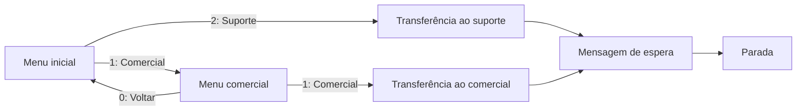

# 2. Do roteiro ao JSON V3

## A entrada: roteiro e catálogo

Abra [examples/triage.json](../examples/triage.json) ao lado de [src/domain/types.ts](../src/domain/types.ts). O roteiro informa sua versão, identidade, nome, conta, etapa inicial e lista de etapas. As conexões usam IDs, não a posição das etapas na lista.

| Tipo de etapa | Campos específicos                            | Como o percurso avança                            |
| ------------- | --------------------------------------------- | ------------------------------------------------- |
| `menu`        | `message`, `options`                          | A resposta escolhe uma opção e segue seu `target` |
| `message`     | `text`, `next`                                | Exibe a mensagem e segue automaticamente          |
| `transfer`    | `departmentId`, `userId`, `next`              | Transfere e segue para a próxima etapa            |
| `stop`        | Nenhum além de `id`, `kind` e `name` opcional | Para o robô naquele caminho                       |

Cada opção de menu tem `id`, `value`, `label` e `target`. Por exemplo, `value: "2"` é a resposta esperada, `label: "Suporte"` é o texto exibido e `target: "transfer-support"` identifica a próxima etapa. `userId: null` significa transferir ao departamento sem fixar um atendente. Parar o robô não é uma operação de fechamento do chamado.

O [catálogo fictício](../examples/catalog.simulated.json) fornece os recursos permitidos. O roteiro guarda seus IDs; o catálogo informa nomes, disponibilidade e vínculos de atendentes com departamentos. `accountId` deve coincidir nos dois documentos.

Esse desenho corresponde aos seis nós do exemplo. O retorno ao início é permitido porque o menu espera uma escolha e há caminho até uma parada.

## A validação

`validateDraft(input, catalog, now)` retorna uma lista de diagnósticos. Lista vazia significa que as validações implementadas passaram. Cada diagnóstico contém `code`, `path` e `message`.

O validador confere o formato dos dados, a validade e atualidade do catálogo, a conta e os recursos escolhidos. Depois verifica IDs duplicados, entrada, destinos, etapas inalcançáveis, possibilidade de chegar a uma parada e ciclos automáticos.

| Exemplo de problema                | Código que ajuda a encontrá-lo |
| ---------------------------------- | ------------------------------ |
| Roteiro de outra conta             | `ACCOUNT_MISMATCH`             |
| Destino que não existe             | `MISSING_TARGET`               |
| Departamento ausente ou inativo    | `DEPARTMENT_UNAVAILABLE`       |
| Atendente fora do departamento     | `USER_DEPARTMENT_MISMATCH`     |
| Etapa sem caminho até uma parada   | `NO_EXIT`                      |
| Mensagem apontando para si mesma   | `AUTOMATIC_CYCLE`              |
| Catálogo com mais de cinco minutos | `CATALOG_STALE`                |

Uma mensagem que aponta para si mesma continua avançando sem esperar o contato; por isso esse ciclo é rejeitado. Já o retorno entre menus do exemplo exige uma resposta. A verificação de saída exige que exista um caminho até uma parada, sem obrigar que toda escolha leve imediatamente a ela.

Alguns erros interrompem as verificações seguintes: um objeto com formato inválido, por exemplo, não é percorrido como um grafo válido. Veja a ordem em [validate.ts](../src/domain/validate.ts).

## A compilação

`compilePreview(input, catalog, now)` chama o validador primeiro. Se houver diagnóstico, retorna `status: "invalid"` e não inclui `bot`. Quando a entrada passa, retorna `status: "preview"`, avisos, informações do catálogo e o objeto `bot`.

O compilador gera três representações coerentes do mesmo atendimento:

| Campo em `bot`    | Conteúdo                                               |
| ----------------- | ------------------------------------------------------ |
| `flowJson`        | Nós, posições e conexões para representar o fluxograma |
| `contexts`        | Contextos com eventos, condições e ações em objetos    |
| `defaultContexts` | String JSON com as regras serializadas para execução   |

Um menu vira um `MESSAGE_NODE`. Ao entrar no contexto, uma ação `SEND_MESSAGE` apresenta o texto; ao receber a resposta, uma condição sobre `message_text` escolhe uma ação `SET_CONTEXT`. Uma transferência vira `TRANSFER_TICKET_NODE`, com ações `TRANSFER_TICKET` e `SET_CONTEXT`.

Nos contextos de edição, os recursos da transferência são objetos com dados como ID e nome. Em `defaultContexts`, a transferência usa os IDs dos recursos. Para inspecionar essa representação, use `JSON.parse(result.bot.defaultContexts)`.

O exemplo tem seis etapas, mas gera oito nós visuais: o compilador acrescenta início e gatilho de mensagem. Com `firstMessageOnly: true`, acrescenta condição e parada; com `stopOnAttendantMessage: true`, acrescenta início persistente, gatilho do atendente e parada. As duas regras juntas levam esse exemplo a treze nós.

Os IDs gerados derivam de um perfil fixo, da conta, do roteiro e dos identificadores internos. A ordenação das etapas torna a saída independente da ordem do array de nós. Com as mesmas entradas e condições de validade, o resultado é determinístico.

## Prévia, exportação e envio

O envelope completo (`CompileResult`) contém diagnósticos e avisos. O corpo enviado à Digisac é o objeto `bot`, não esse envelope. Na aplicação, o backend recompila o roteiro antes de enviá-lo.

`importReady` permanece `false` mesmo quando o resultado é `preview`: passar nas regras locais não equivale à homologação completa na Digisac. O catálogo fictício permite estudar a compilação, mas a interface bloqueia a exportação do objeto de robô nesse modo.

Próximo: [interface, API e conexão](03-interface-api-e-conexao.md).
