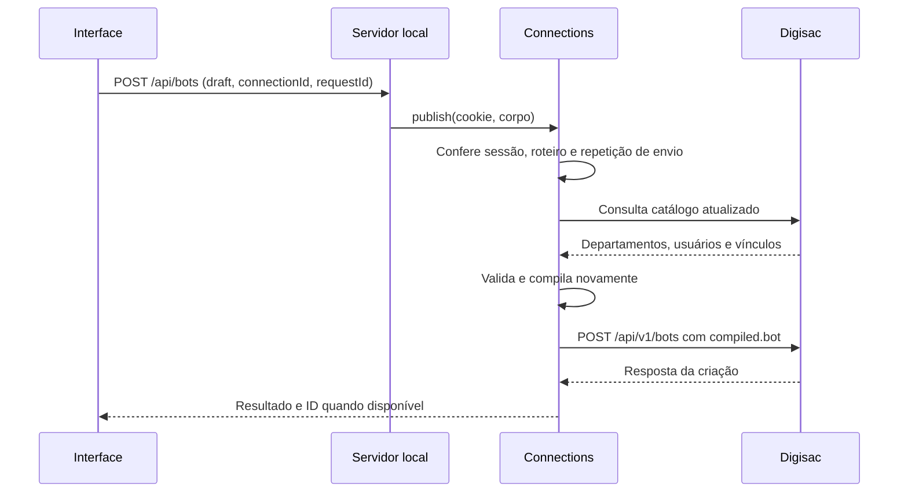

# 3. Interface, API e conexão

## Acompanhe uma edição

1. A interface consulta `/api/bootstrap` para obter roteiro inicial, catálogo e perfis disponíveis.
2. A pessoa usa o assistente ou o editor por caminhos. Ambos produzem um `Draft`.
3. Uma edição atualiza o estado da interface e invalida a prévia anterior. A aplicação solicita a preparação da versão atual em `/api/preview`.
4. O servidor obtém o catálogo do perfil escolhido e chama `compilePreview`.
5. A interface mostra pendências ou disponibiliza as ações compatíveis com a prévia e com o tipo de catálogo.

Leia os efeitos de preparação da prévia e as funções `update`, `save`, `publish` e `download` em [App.tsx](../web/src/App.tsx). [api.ts](../web/src/api.ts) transforma erros HTTP em `ApiError`; a resposta 422 com `status: "invalid"` é devolvida como resultado de validação para a interface apresentar os diagnósticos.

## Mapa da API local

As rotas abaixo pertencem ao criador, implementadas em [src/server.ts](../src/server.ts).

| Método e rota                     | Função                                                                            |
| --------------------------------- | --------------------------------------------------------------------------------- |
| `GET /api/bootstrap?profile=demo` | Carrega o estado inicial e os perfis                                              |
| `GET /api/catalog?profile=demo`   | Obtém o catálogo selecionado                                                      |
| `POST /api/preview?profile=demo`  | Recebe um `Draft` diretamente no corpo e devolve a compilação                     |
| `GET /api/connection`             | Consulta o resumo da sessão atual                                                 |
| `POST /api/connection`            | Recebe `origin`, `username` e `password` para conectar                            |
| `POST /api/disconnect`            | Encerra a sessão; recebe um corpo JSON, como `{}`                                 |
| `POST /api/bots`                  | Recebe `draft`, `connectionId` e `requestId` para criar o robô na conta conectada |

Os perfis são `demo` (fictício), `qa` (cópia local datada) e `live` (conexão real). A interface usa `X-Connection-Id` nas consultas do perfil conectado para detectar mudanças de conexão entre abas. A rota de publicação verifica o `connectionId` enviado no corpo.

O backend seleciona o catálogo; `/api/preview` não aceita um catálogo fornecido pelo navegador como fonte de autoridade. O catálogo QA é um arquivo local: seu horário de leitura não representa uma nova consulta à plataforma.

## Simulação e persistência

As funções `follow` e o componente `Conversation`, em [App.tsx](../web/src/App.tsx), percorrem o roteiro no navegador. A conversa mostra mensagens, espera respostas de menus e representa transferências e paradas. Isso permite testar o roteiro sem executar o JSON na Digisac.

| Local               | O que fica armazenado                                     | Limite                                                |
| ------------------- | --------------------------------------------------------- | ----------------------------------------------------- |
| Estado React        | Edição aberta e alterações temporárias do assistente      | Recarregar perde alterações que não foram preservadas |
| `localStorage`      | Rascunho por conta e preferências                         | Vinculado ao navegador e à origem do site             |
| `sessionStorage`    | Informações de navegação, como área de trabalho aberta    | Vinculado à sessão da aba                             |
| Memória do servidor | Sessões Digisac, tokens e controle de repetição de envios | Reinício elimina esses dados                          |
| Cookie HttpOnly     | Identificador da sessão do servidor                       | Não contém o Bearer da Digisac                        |

Não há sincronização de rascunhos entre dispositivos. Salvar um rascunho não cria um robô na plataforma. No assistente, as mudanças temporárias só passam ao roteiro principal quando a pessoa cria o rascunho.

## O caminho de um envio real

O diagrama mostra um envio novo bem-sucedido. Repetições reconhecidas podem reutilizar o resultado guardado na sessão. Falhas de validação interrompem o fluxo antes do POST externo.

`Connections` coordena sessão e envio; `DigisacClient` executa a comunicação HTTP. A senha é usada no login e o Bearer permanece na memória do servidor. O cookie recebe `Secure` no ambiente HTTPS configurado.

O controle de repetição usa o identificador da requisição e uma impressão digital do conteúdo gerado. Ele dura apenas durante a sessão. Um resultado `unknown` significa que a criação ficou sem confirmação; a pessoa deve conferir a plataforma antes de tentar outro envio. Criar o robô não ativa seus canais.

Próximo: [laboratório e exercícios](04-laboratorio.md).
